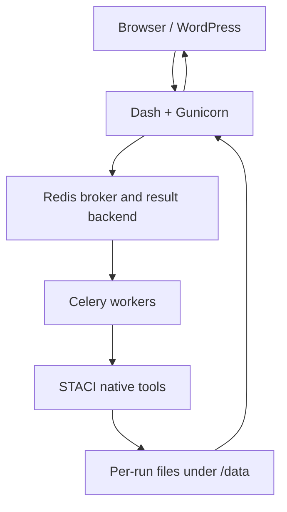
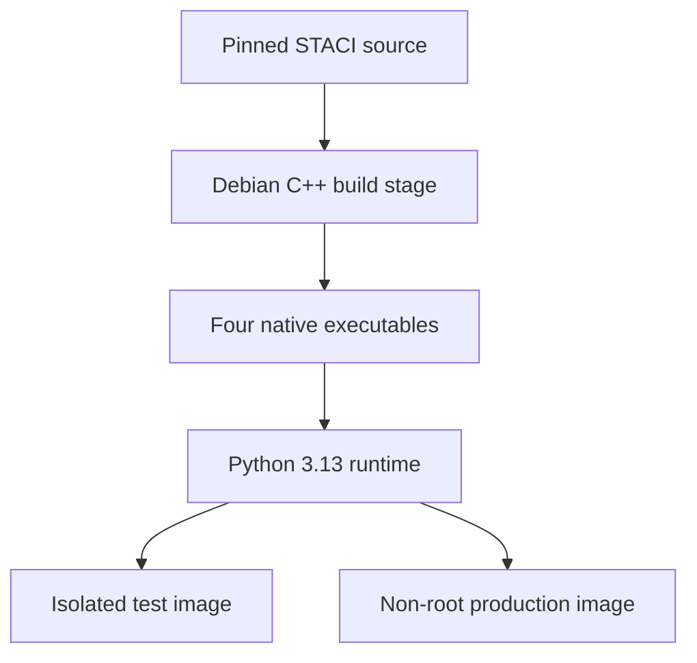

# STACI UI

STACI UI is a browser-based engineering application for loading, running, and
inspecting EPANET-compatible water-distribution network models with the native
STACI tools.

The application is built with Python, Dash, Celery, Redis, and Plotly. Long-running
solver operations execute as background jobs so that the web application remains
responsive while simulations are running.

> **Status:** MVP-level engineering application under active development. The
> hydraulic simulation, network partitioning, flushing-plan, pipe-calibration,
> visualization, background-processing, and containerized deployment workflows
> are implemented.

## Features

### Network model

- Upload EPANET `.inp` network files
- Enforce configurable file and request-size limits
- Parse and summarize models with WNTR
- Preview network topology and static node/link properties
- Configure node size, link width, visibility, properties, and color ranges
- Keep uploaded models and solver runs separated by generated identifiers

### Hydraulic simulation

- Run native **STACI EPS** simulations
- Use **WNTR** as a reference backend
- Use timing options from the INP model or override:
  - simulation duration
  - hydraulic timestep
  - report timestep
  - rule timestep
  - demand multiplier
- Store STACI hydraulic results in HDF5
- Store WNTR reference results as per-run CSV files
- Visualize pressure head, total head, demand, flow rate, velocity, and headloss
- Navigate through timesteps or play results as an animation
- Display non-converged STACI frames and failed-frame counts

### Network partitioning

- Run the native **`staci_split`** optimizer
- Select the target number of network communities
- Weight links using:
  - network topology
  - calculated pressure drop
  - hydraulic sensitivity
- Configure sensitivity parameters and genetic-algorithm settings
- Filter displayed communities
- Highlight links crossing community boundaries
- Visualize partition membership using node colors

### Flushing plan

- Run native **`staci_flush`** calculations
- Evaluate individual or combined hydrant-opening scenarios
- Configure outlet area, loss coefficient, velocity threshold, and minimum pressure
- Rank flushing steps by newly covered pipe volume
- Inspect scenario status and pressure constraints
- Visualize active hydrants, pipe velocities, and flushing coverage
- Optionally retain generated scenario networks

### Pipe diameter calibration

- Run native **`staci_calibrate`** optimization
- Upload multiple INP snapshots independently of the main network workflow
- Include or exclude individual snapshots
- Upload measurements as JSON
- Review and edit measurement data in the browser
- Validate compatible network identifiers across snapshots
- Select candidate pipes by:
  - largest diameter
  - hydraulic sensitivity
  - diameter cutoff
  - explicit pipe list
  - all pipes
- Configure diameter bounds and genetic-optimizer settings
- Inspect calibrated pipe diameters, optimization history, and residuals

### Background execution

Hydraulic simulation, partitioning, flushing, and calibration run through Dash
background callbacks backed by Celery and Redis.

- Solver work runs outside the Gunicorn process
- Web requests remain responsive while jobs execute
- Redis carries queued tasks and background-callback results
- Celery worker concurrency is configurable
- Duplicate submissions are prevented while a workflow is running
- Solver files and results remain on shared server-side storage

## Architecture



Browser-side stores contain generated identifiers and lightweight metadata.
Uploaded models, native solver output, and result arrays remain on the server.

The native tools included in the Docker image are:

- `staci`
- `staci_split`
- `staci_flush`
- `staci_calibrate`

## Project structure

```text
staci-ui/
├── app.py
├── Dockerfile
├── compose.yaml
├── compose.dev.yaml
├── Caddyfile
├── pyproject.toml
├── requirements.txt
├── requirements-dev.txt
├── requirements-deploy.txt
├── assets/                    # Application styles
├── benchmarks/                # Ad hoc responsiveness experiments
├── deploy/                    # WordPress and deployment integration
├── src/
│   ├── background_jobs.py     # Celery and Dash background manager
│   ├── config.py              # Runtime configuration
│   ├── logging_setup.py       # Process and rotating-file logging
│   ├── results/               # Hydraulic and calibration result adapters
│   ├── services/              # Application workflow and persistence layer
│   ├── staci/                 # Native executable wrappers
│   ├── ui/                    # Dash pages, callbacks, IDs, and shell
│   └── visualisation/         # Shared Plotly figure builders
├── tests/
│   ├── integration/
│   └── unit/
└── data/                      # Local runtime data
    ├── uploads/
    └── runs/
```

## Local development with Docker

The development Compose file starts the Dash application, Redis, and a Celery
worker without starting the WordPress deployment stack.

```bash
docker compose -f compose.dev.yaml up --build
```

Open:

```text
http://127.0.0.1:8050/staci-app/
```

Python source, CSS assets, and the local `data/` directory are bind-mounted into
the containers. Gunicorn reloads when Python source files change. Rebuild the image
when dependencies or the Dockerfile change.

Stop the development stack with:

```bash
docker compose -f compose.dev.yaml down
```

To follow application and worker output:

```bash
docker compose -f compose.dev.yaml logs -f app worker
```

## Configuration

The application is configured through environment variables.

| Variable | Purpose | Default / notes |
| --- | --- | --- |
| `STACI_UI_URL_PREFIX` | Dash URL prefix | `/staci-app/` |
| `STACI_UI_DATA_DIR` | Runtime data directory | Local `data/`; Docker uses `/data` |
| `STACI_TIMEOUT_SECONDS` | Native solver timeout | `300` seconds |
| `STACI_UI_MAX_INP_UPLOAD_MIB` | Maximum size of one INP file | `20` MiB |
| `STACI_UI_MAX_UPLOAD_REQUEST_MIB` | Maximum complete upload request | `128` MiB |
| `CELERY_BROKER_URL` | Celery task broker | `redis://localhost:6379/0` |
| `CELERY_RESULT_BACKEND` | Background-result backend | `redis://localhost:6379/1` |
| `CELERY_RESULT_EXPIRES_SECONDS` | Background-result retention | `3600` seconds |
| `CELERY_WORKER_CONCURRENCY` | Worker processes in Compose | `2` |
| `PORT` | Gunicorn listening port | `8050` |
| `DASH_DEBUG` | Enable Dash debug mode | `0` |
| `STACI_EXECUTABLE` | Path to `staci` | Automatically resolved |
| `STACI_SPLIT_EXECUTABLE` | Path to `staci_split` | Automatically resolved |
| `STACI_FLUSH_EXECUTABLE` | Path to `staci_flush` | Automatically resolved |
| `STACI_CALIBRATE_EXECUTABLE` | Path to `staci_calibrate` | Automatically resolved |

An example production environment file is provided as `.env.example`.

Authentication is handled by WordPress and Caddy. Never expose the application
port publicly: access must pass through the supplied Caddy configuration.

## Docker deployment

The application image uses a multi-stage build:



The image currently pins STACI to revision:

```text
f1987bffcbeea5ae045e765b649ae5c9eca06ece
```

The build enables the STACI optimizer targets and verifies the runtime
shared-library dependencies before completing the image.

### Build

```bash
docker build -t staci-ui .
```

### WordPress deployment

The supplied Compose stack runs Caddy, WordPress, MariaDB and STACI. A one-shot
initialization service installs WordPress with the administrator configured in
`.env`, preserving existing installations. Only Caddy
publishes ports. It checks the WordPress session before forwarding every request
under `/staci-app/`, including Dash callbacks and assets. WordPress displays the
existing UI through the `[staci_tool]` shortcode supplied by the STACI Tool plugin.

Follow [the VPS deployment guide](deploy/README.md) to configure `.env`, initialize
WordPress, activate STACI Tool and Force Login, and create the tool page.

Uploaded models and solver run directories remain under `/data/uploads` and
`/data/runs` in the `staci-data` volume. Storage is shared between authenticated
users, without per-user ownership or a history browser.

### Logs

Application workflow events and callback exceptions are written through Python logging to the process output. With Docker they can be inspected using:

```bash
docker compose logs -f app worker
```

Gunicorn and application logs remain available through Docker. Compose also
writes app and Celery-worker Python logs to `/var/log/staci/application.log` on the
`staci-logs` volume, with five rotated backups of 5 MiB each. Application events
include the proxy-verified WordPress user ID/login; timestamps are UTC.
Administrators can browse and filter runs under **Tools → STACI napló** in
WordPress, open a run’s log, download its original uploaded file and copy a
reproduction summary. Downloads require the same administrator permission and a
session-bound link; unavailable files have no download button. The raw log viewer
remains available. Log and runtime data volumes are mounted read-only in
WordPress and are outside
the public web root. Existing Docker history is not imported. See the
[deployment guide](deploy/README.md#user-attributed-application-logs) for details.

## Testing and code quality

Install development dependencies:

```bash
python -m pip install -r requirements-dev.txt
```

Run Ruff linting:

```bash
python -m ruff check app.py src tests
```

Check formatting without modifying files:

```bash
python -m ruff format --check app.py src tests
```

Apply formatting:

```bash
python -m ruff format app.py src tests
```

Run tests that do not require native STACI executables:

```bash
python -m pytest -m "not staci" -vv
```

Build and run the complete Linux test suite with the bundled native tools:

```bash
docker build --target test -t staci-ui:test .
docker run --rm staci-ui:test
```

GitHub Actions performs:

- Ruff lint and formatting checks
- Python tests without native STACI
- Full Docker-based native STACI tests
- Redis, Celery, and Dash background-callback verification
- WordPress/PHP runtime and security checks

The `benchmarks/` directory contains ad hoc responsiveness experiments created
during the background-job implementation. It is intentionally outside the
continuously maintained Ruff and CI scope. See
[`benchmarks/README.md`](benchmarks/README.md) for its usage.

## Runtime data

Runtime data is stored under the configured data directory:

```text
data/
├── uploads/
└── runs/
    ├── hydraulic/
    ├── partition/
    ├── flushing/
    └── calibration/
```

Uploaded source files and solver runs are stored separately. The application does
not currently perform automatic retention or pruning. Persistent deployments
should manage cleanup according to their storage and audit requirements.

## STACI

STACI is a separate C++ hydraulic-network solver developed at the
**BME Department of Hydrodynamic Systems**.

Upstream repository:

<https://github.com/hoscsaba/staci>

This repository contains the web application and integration layer. STACI itself
is a separate project and is not covered by this repository's MIT license.

## License

Original code in this repository is released under the **MIT License**.

STACI and other third-party components remain subject to their respective
licenses.